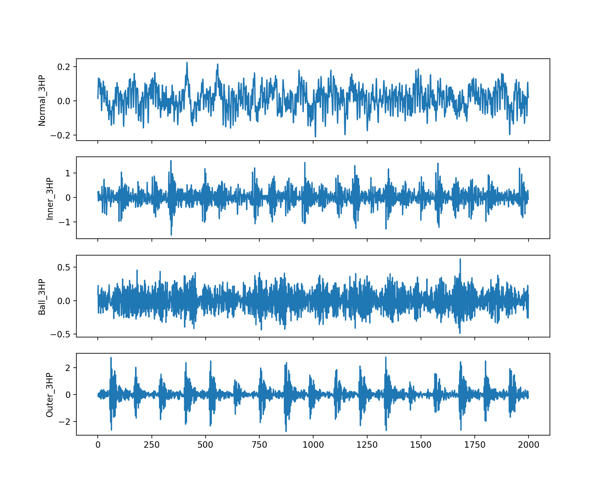
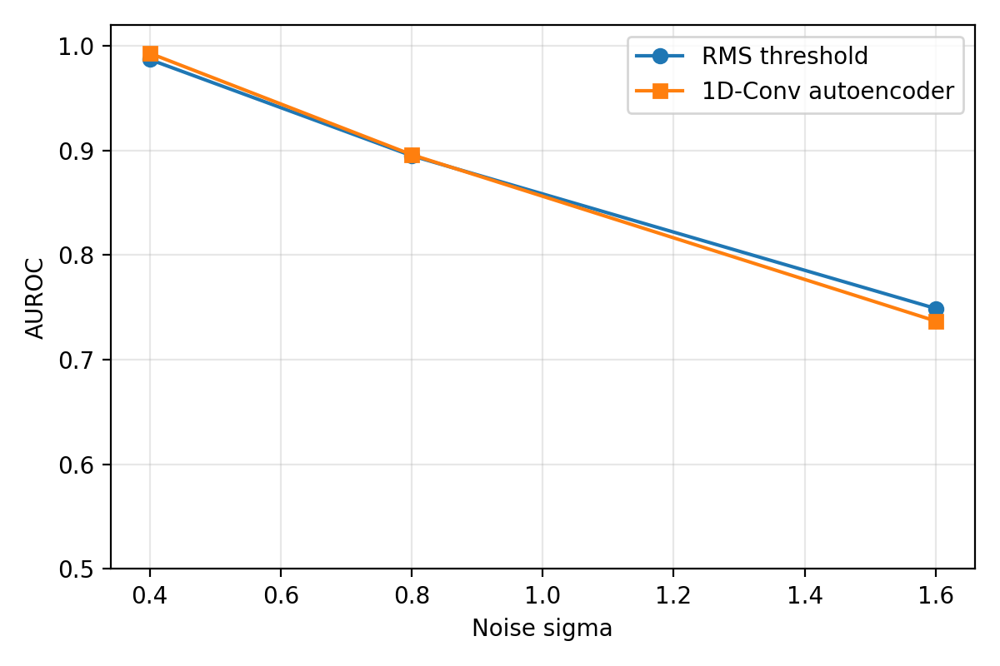

# 軸承異常偵測：RMS 閾值法 vs 輕量自編碼器

## 問題
固定閾值告警在雜訊增加時會失效。本專題在 CWRU 軸承資料集上，
比較 RMS 閾值法與 1D 卷積自編碼器，並對自編碼器做 int8 量化。

## 資料與切分
- 資料：CWRU Bearing Data Center（12 kHz 驅動端；請至官網自行下載，本 repo 不含資料檔）
- 訓練：僅正常資料，負載 0/1/2 HP
- 測試：負載 3 HP 的正常與三種故障（內圈、滾珠、外圈，0.007 吋）
- 以負載切分，避免相鄰視窗造成資料洩漏；視窗 1024 點、步長 512
- 以加入高斯白雜訊（σ）模擬感測雜訊
- 異常分數：RMS 閾值法用 RMS；自編碼器用重建誤差。
  閾值皆為訓練資料分數的「平均 + 3 倍標準差」

## 波形

## 結果
| σ | RMS AUROC | AE AUROC | RMS F1 | AE F1 |
|---|---|---|---|---|
| 0.4 | 0.987 | 0.993 | 0.881 | 0.933 |
| 0.8 | 0.895 | 0.896 | 0.680 | 0.693 |
| 1.6 | 0.749 | 0.737 | 0.260 | 0.226 |

兩種方法表現相近，差距可能在隨機波動範圍內，不能據此宣稱自編碼器較佳。

## 模型與量化
1D 卷積自編碼器，9,593 參數；
TFLite float32 49.6 KB，int8 量化 25.3 KB（輸入輸出為 float）。
σ = 0.4 時，Keras、TFLite float32、TFLite int8 的
AUROC 皆為 0.993、F1 皆為 0.933（量化未造成可觀察的準確度損失）。
Colab CPU 單窗推論：float32 0.21 ms，int8 0.31 ms
（int8 在此環境未見加速；未於樹莓派或微控制器驗證）。

## 限制
- 只用單一亂數種子，差異可能在隨機波動內
- 雜訊為模擬的高斯白雜訊，非真實現場
- CWRU 為實驗室人工植入故障，不等於現場自然劣化
- 延遲僅在 Colab CPU 量測，未在樹莓派或微控制器驗證
- RMS 是較弱的基準線，尚未與峭度或頻域特徵比較

## 檔案
- `main.ipynb`：完整程式
- `ae_float32.tflite`、`ae_int8.tflite`：σ = 0.4 的模型
